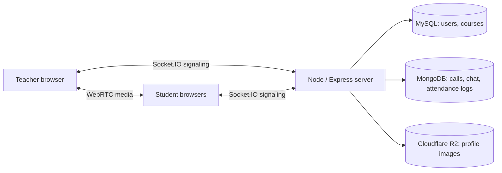

# TeachMe

A live-classroom web app: teachers start a video lecture for a course, enrolled students join, and everyone can chat. After class the teacher gets an attendance report.

**Live demo:** _add your Render link here_ (free tier, the first load can take ~30 s to wake up)

## Features

- **Roles:** teachers and students with separate dashboards and logins.
- **Courses:** teachers create courses; students enrol.
- **Live video lectures:** teacher broadcasts to many students using WebRTC (one peer connection per student), with camera switching.
- **Signaling:** Socket.IO exchanges offers, answers and ICE candidates, and tracks who is online.
- **Chat:** per-lecture messages, stored with the call.
- **Attendance reports:** every join/leave is logged; the teacher sees per-day reports with total lecture time, number of attendees, and per-student login count, time attended and connect/disconnect times.
- **Profile images:** uploaded to Cloudflare R2.

## Tech stack

| Layer | Tech |
|---|---|
| Client | React 18, Vite, Tailwind CSS |
| Server | Node.js, Express, Socket.IO |
| Realtime video | WebRTC (peer-to-peer, signaled over Socket.IO) |
| Relational data | MySQL (users, courses, enrolments) |
| Call data | MongoDB with Mongoose (`Call`: offer/answer, messages, student logs) |
| File storage | Cloudflare R2 |
| Hosting | Render |

## Architecture



Two databases on purpose: relational data (users, courses, enrolment) fits MySQL; each call is one document in MongoDB holding messages and a log of student connections.

## Project layout

```
browser/            React client
  src/pages/        Room (live lecture), ReportPage, Home, ...
  src/Components/   Navbar, drawer, modal, chat, ...
server/
  index.js          Express + Socket.IO + DB connections
  socketHandler.js  Signaling and attendance logging
  controllers/      teacher_controller, stu_controller
  models/           MySQL models and the Mongoose Call model
  routes/           REST routes
  db/               SQL schema files (run in order 01 to 08)
```

## Run locally

```bash
# server
cd server
npm install
# configure MySQL, MongoDB and R2 values (see .env.example)
npm start

# client
cd browser
npm install
npm run dev
```

## Known limitations and what I would change

- Passwords should be hashed (bcrypt) and sessions should use tokens (JWT) instead of sending credentials in headers.
- WebRTC is mesh-style (teacher connects to each student), which does not scale to large classes; an SFU such as mediasoup or LiveKit would.
- No automated tests yet.
- Free-tier hosting means cold starts.
