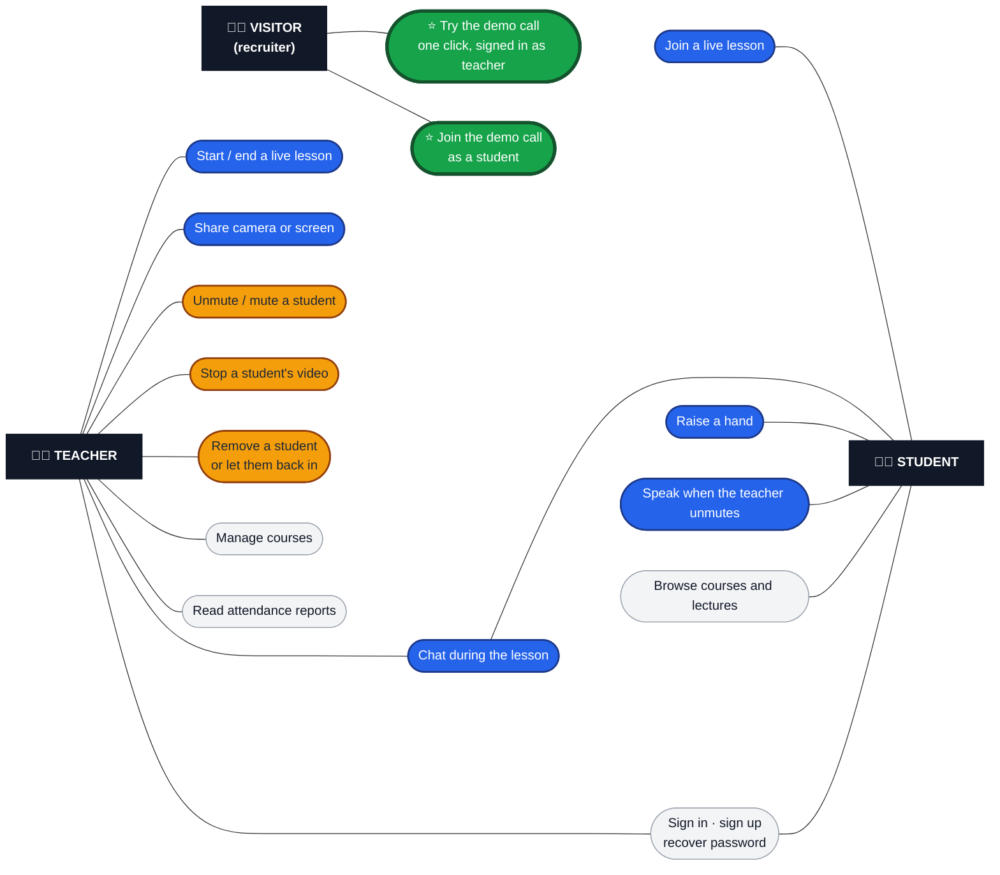
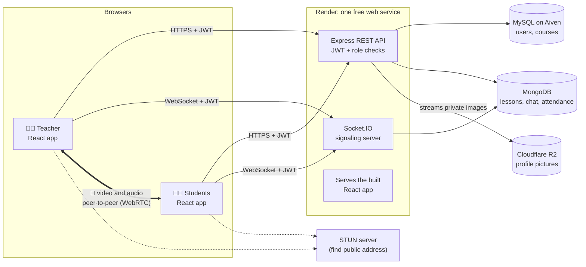
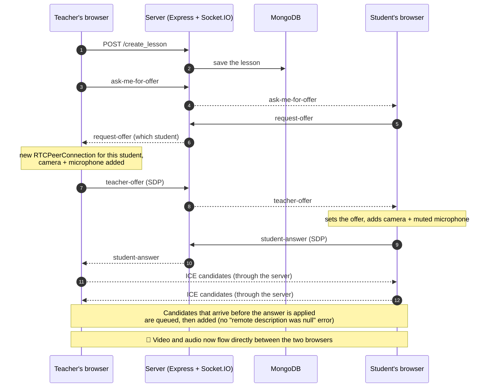

<div align="center">

# 🎓 TeachMe

**A live-class platform in the browser: a teacher starts a video lesson, students join, and the teacher stays in control.**

[**▶ Try the live demo**]() &nbsp;·&nbsp; [Quick start](#-try-it-in-60-seconds) &nbsp;·&nbsp; [How it works](#-how-it-works) &nbsp;·&nbsp; [Run it locally](#-run-it-locally)


</div>

## What it is

TeachMe lets a teacher run a **live video lesson** for the students of a course. Students join from any modern browser, no install. The video goes **directly between the browsers (WebRTC)**; the server only introduces them to each other. The teacher can hear or mute each student, stop their video, or remove them, and every lesson is logged for attendance reports.

Built end to end by me: React front end, Node.js back end, real-time signaling, authentication, and deployment.

---

## ⚡ Try it in 60 seconds

No sign-up, no passwords. The demo signs you in with one click.

1. **Open the [live demo](https://YOUR-APP.onrender.com).** The free hosting sleeps when idle, so the first load can take up to a minute.
2. **Turn your VPN off** and allow the camera when asked (video calls usually don't work through a VPN).
3. **Click "Try a demo video call"** (bottom right). You are signed in as the **teacher**, taken to the lesson, and your camera starts.

   

4. **Open the site again in a second window** (a private/incognito window, another browser, or your phone). The button now says **"Join the demo call as a student"**. Click it and allow the camera and microphone.

   

5. **Play with the controls:** raise the student's hand, unmute the student from the teacher window, share the screen, stop the student's video, or remove them.

> **Tip:** if you were given the link of a running lesson, just open it in a private window. TeachMe shows a **"Join as a demo student"** card.

---


## ✨ What you can do in the call

| | Teacher | Student |
| --- | --- | --- |
| **Video & audio** | Starts the lesson (camera starts by itself), switches camera | Sees and hears the teacher |
| **Screen sharing** | Shares a screen instead of the camera, live, for everyone | Sees the screen |
| **Hear students** | Unmute / mute any single student (students are muted by default) | Speaks only when the teacher allows it |
| **Raise hand** | Sees a badge and a banner on the student's tile | Raises or lowers the hand |
| **Moderation** | Stops one student's video, or removes a student (and can let them back in) | Is told what happened |
| **Chat** | Sees and answers messages | Writes messages |
| **Attendance** | Per-lesson reports with join and leave times | – |

### Who can do what

Green is what a visitor can try right now, blue is the live call, orange is moderation, grey is everyday account and course management.



---

## 🧠 How it works

### The big picture



The teacher keeps **one WebRTC connection per student** (a star, not a server in the middle). The server never touches the video; it only relays small signaling messages and enforces who is allowed to do what.

### How a call is set up




## 🛠 Engineering highlights

- **Real-time signaling done carefully.** The offer, answer, and ICE-candidate handshake runs over Socket.IO. Candidates that arrive early are queued until the remote description exists, which avoids a classic WebRTC race.
- **Live screen share without renegotiation.** The camera track is swapped for the screen track with `replaceTrack`, including for students who join mid-share.
- **Server-enforced moderation.** Mute, stop-video, and remove events are accepted only from the teacher who owns the lesson. A removed student gets no offers, answers, or candidates until let back in.
- **Authentication and security basics.** bcrypt password hashing, signed JWTs (also checked in the Socket.IO handshake), role middleware, ownership checks on every teacher resource, per-IP rate limiting on login routes, Helmet headers, path-traversal protection on file routes.
- **Private image storage.** Profile pictures live in a private Cloudflare R2 bucket and are streamed through the API, so no public bucket URL is needed and the free host's disk is never used.
- **One deployable.** The Express server also serves the built React app, so the whole project runs as a single free Render service.
- **Privacy-minded analytics.** A visit counter stores only a date in MongoDB (one per browser, bots skipped). A privacy notice explains this on first visit.

**Honest limits:** media is peer-to-peer from the teacher to every student, which suits classes of a handful of students (a larger class would need a media server). Only STUN is configured, no TURN relay, so some VPNs and strict corporate networks can block the call. Lecture PDF uploads are switched off in the demo because the free host's disk is temporary.

---

## 🧰 Tech stack

| Area | Technology |
| --- | --- |
| Front end | React 18, Vite, Tailwind CSS, React Router, Axios, lucide-react |
| Real time | WebRTC (native `RTCPeerConnection`), Socket.IO |
| Back end | Node.js, Express, Helmet, Multer, Nodemailer |
| Data | MySQL (mysql2, hosted on Aiven), MongoDB (Mongoose) |
| Files | Cloudflare R2 (S3 API) |
| Auth | bcryptjs, JSON Web Tokens |
| Hosting | Render (free tier) |

---

## 💻 Run it locally

> The easiest way to evaluate TeachMe is the [live demo](#-try-it-in-60-seconds). A local run needs your own databases, and the MySQL table definitions are not part of this repository.

You need Node.js 20+, a MySQL database with the TeachMe tables, and a MongoDB database (a free Atlas cluster works).

```bash
# 1. Install and build the front end (it is copied into server/dist)
cd client
npm install
node build.js

# 2. Configure and start the server
cd ../server
npm install
cp .env.example .env        # then fill it in (see below)
npm start                   # http://localhost:3000
```

**Environment variables** (`server/.env`, see `.env.example` for comments):

| Variable | Purpose |
| --- | --- |
| `JWT_SECRET` | **Required.** Long random string (32+ characters) used to sign tokens |
| `DB_HOST`, `DB_PORT`, `DB_USER`, `DB_PASSWORD`, `DB_NAME` | MySQL connection |
| `DB_CA` | MySQL CA certificate text (needed for Aiven) |
| `MONGO_URI` (or `MONGO_CLUSTER`, `MONGO_USER`, `MONGO_PASSWORD`, `MONGO_DB`) | MongoDB connection |
| `CLIENT_ORIGIN` | Your site's address, for CORS |
| `R2_ACCOUNT_ID`, `R2_ACCESS_KEY_ID`, `R2_SECRET_ACCESS_KEY`, `R2_BUCKET` | Cloudflare R2 for profile pictures |
| `GMAIL_USER`, `GMAIL_APP_PASSWORD` | Optional: sends account-recovery emails |

**Accounts:** teachers have no sign-up page, so they are created with a script (students sign up in the app):

```bash
cd server
node scripts/create-account.js teacher "Ada" "Lovelace" ada@example.com "a-strong-password"
node scripts/seed-demo.js   # optional: the demo teacher, demo student and demo course used by the live demo
```

---

## 📁 Project layout

```
client/                      React + Vite + Tailwind
  src/pages/Room.jsx           the live room: WebRTC, screen share, controls
  src/Components/DemoGuide/    one-click demo and "join as student" cards
server/
  index.js                     Express app, security headers, serves the client
  socketHandler.js             signaling + classroom controls (raise hand, mute, remove)
  controllers/, routes/        REST API for teachers and students
  middleware/auth.js           JWT + role checks
  config/r2.js                 private image storage on Cloudflare R2
  models/                      MySQL access and Mongoose models
  scripts/                     seed-demo.js, create-account.js
```

---

<div align="center">

**Built by Sami**

</div>
